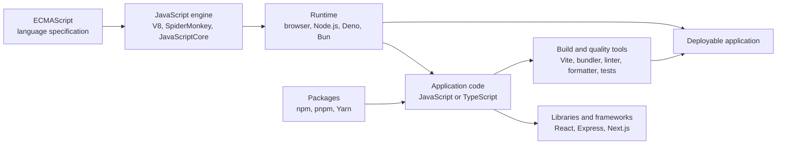

# The JavaScript Ecosystem Explained

- **Video:** [The Complete JavaScript Ecosystem Explained in 20 Minutes](https://youtu.be/yMbUr5op98Y)
- **Creator:** Cloud X Berry
- **Download:** [PDF version](javascript-ecosystem-video-notes.pdf)
- **Audience:** Beginners and developers who want the JavaScript tools connected into one mental model.

> **Source note:** The video’s public description and chapter list were accessible, but its captions and playback were not. The timestamps below follow those published chapters. The explanations, diagram, and code are original study material for the named topics; they are not a transcript or a claim that each example appears in the video.


*The image above is the video’s published thumbnail, not a captured lecture frame. The flowchart below is a study visualization created for these notes.*

## The one-minute mental model

JavaScript is the language. ECMAScript specifies the language; an engine executes it; a runtime surrounds the engine with APIs; libraries and frameworks help build applications; package managers install reusable packages; and development tools help check, bundle, test, and deliver code.



**Keep the layers separate:** React is not a runtime; npm is not the language; TypeScript is not what a browser directly executes; and Node.js is more than the V8 engine.

## Chapter notes

### 0:00 — Why JavaScript seems confusing

The ecosystem has many names because different tools solve different problems. Asking “Which layer is this?” is more useful than treating every name as a competing JavaScript.

### 0:48 — ECMAScript: the rulebook

**ECMAScript** is the language specification: it describes JavaScript syntax and behavior. Engines implement the specification. The standard evolves over time, and support for a feature can vary across engines and runtime versions.

**Remember:** specification = what the language means; engine = a program that implements and executes it.

### 1:10 — JavaScript engines

An engine parses and executes JavaScript. **V8** is used by Chrome and Node.js. Other engines include SpiderMonkey and JavaScriptCore.

Engines can interpret code and optimize frequently executed (“hot”) code while it runs. That combination is one reason the simplistic statement “JavaScript is only interpreted” is misleading.

### 2:01 — Runtimes: browser, Node.js, Deno, Bun

A runtime is an execution environment: it includes an engine and APIs that let a program interact with its surroundings.

| Environment | Typical APIs and use |
|---|---|
| Browser | DOM, events, `fetch`, storage; interactive websites |
| Node.js | Filesystem, process, networking; servers and scripts |
| Deno | Server-side JavaScript/TypeScript runtime and tooling |
| Bun | JavaScript runtime with a bundled set of development tools |

Runtime APIs differ. Browser code cannot normally use Node’s `fs` API, and server-side code does not automatically have a browser DOM.

**Small example — same language, different runtime API:**

```js
// Browser: display a message in the page.
document.querySelector("#status").textContent = "Ready";
```

```js
// Node.js: read a local text file.
import { readFile } from "node:fs/promises";

const text = await readFile("notes.txt", "utf8");
console.log(text);
```

The syntax is JavaScript in both examples; the available host APIs are different.

### 3:57 — Compiled vs. interpreted

“Compiled” and “interpreted” describe ways code is translated and executed, but real engines can combine techniques. JavaScript source is parsed; an engine can execute it and optimize selected code during execution. Avoid using these labels as if every language had exactly one fixed execution strategy.

### 5:33 — JIT: how JavaScript got fast

**Just-in-time (JIT) compilation** performs optimization while a program runs. A typical engine may start with quick execution, observe code, and optimize frequently used paths into machine code.

Optimization has trade-offs: it takes work to collect information and compile, and assumptions can become invalid. Engine internals differ; this is a mental model, not a promise of one exact pipeline.

### 6:45 — One thread and the event loop

JavaScript commonly runs application callbacks on one main thread per execution context. The event loop coordinates queued work. Many I/O operations are handled by the host environment, so JavaScript can continue while a file or network operation is pending.

```js
console.log("A");
setTimeout(() => console.log("timer"), 0);
Promise.resolve().then(() => console.log("promise"));
console.log("B");
```

**Output:**

```text
A
B
promise
timer
```

Synchronous statements run first. Promise reactions (microtasks) run before the timer callback (a task) in this example. A zero-millisecond timer means “eligible later,” not “run immediately.” Long synchronous work still blocks that thread.

### 8:38 — Libraries vs. frameworks

A **library** offers functions your application calls. A **framework** usually provides a broader structure or conventions for an application. The boundary is not always strict.

| Tool | Role (simplified) |
|---|---|
| React | UI library |
| Next.js | Application framework built around React |
| Express | Web framework commonly used with Node.js |

Choose based on the problem and project constraints, not because one label is universally better.

### 10:13 — npm, packages, and lockfiles

A **package** is reusable code distributed for use in projects. **npm** refers to both the npm registry and the npm command-line tooling commonly used to install packages and run project scripts. **pnpm** and **Yarn** are alternative package managers.

- `package.json` declares project metadata, scripts, and dependency ranges.
- A lockfile records the resolved dependency tree to make installs more reproducible.
- `node_modules` contains installed packages and is normally generated by installation.

Example project manifest:

```json
{
  "scripts": {
    "test": "node --test"
  },
  "dependencies": {
    "left-pad": "1.3.0"
  }
}
```

The example dependency is deliberately illustrative; check package health and necessity before adding any real dependency. Use the package manager’s lockfile consistently in a project.

### 12:16 — Supply-chain risks

Package ecosystems create a dependency supply chain: your application may trust packages, their maintainers, and the tools that install them. A compromised package or maintainer account can therefore affect downstream projects. The video description names the **Shai-Hulud** supply-chain worm as an example.

Practical habits:

1. Add only dependencies you need; check the package identity and maintenance history.
2. Review dependency and lockfile changes in code review.
3. Keep dependencies updated through a deliberate review process.
4. Protect publishing and repository accounts with strong authentication and least privilege.
5. Do not expose secrets to untrusted install scripts or build steps.

These habits reduce risk; they do not guarantee that a dependency is safe.

### 13:42 — TypeScript

**TypeScript** adds static types and development tooling to JavaScript. A type checker can detect some inconsistencies before execution. Type annotations are generally erased or transformed during compilation; production JavaScript still runs in a JavaScript engine.

```ts
function totalWithTax(price: number, taxRate: number): number {
  return price * (1 + taxRate);
}

console.log(totalWithTax(100, 0.05)); // 105
// totalWithTax("100", 0.05);        // Type error during checking
```

Types do not automatically validate untrusted input at runtime. An API receiving JSON still needs runtime validation. The video description specifically mentions TypeScript 7 being written in Go; this is a version/project detail, not necessary to understand TypeScript’s role.

### 15:16 — Build tools: Vite and Rolldown

Build tools coordinate development and production steps: serving code during development, transforming modules, bundling assets, and preparing output for deployment. **Vite** and **Rolldown** are named in the video description.

Not every project needs identical build steps. Use a tool that fits the target environments, dependencies, and deployment process; understand what its scripts actually do.

### 16:27 — Linters, formatters, and tests

| Tool category | Main question it answers |
|---|---|
| Linter | “Is this code pattern suspicious or against project rules?” |
| Formatter | “Is the source laid out consistently?” |
| Test | “Does this behavior match the expected result?” |

They are complementary. Formatting does not prove correctness; a clean lint report does not replace tests; passing tests only cover the behaviors they exercise.

### 17:33 — ES2015 and yearly updates

**ES2015** was a major ECMAScript release. The standard continues to evolve. New features may not be supported by every browser or runtime version, so check compatibility for the environments your application supports.

**Temporal** is a date-and-time API named in the chapter description. Before relying on a feature in production, verify its current support and any required polyfill for your target runtimes.

### 18:26 — Node.js LTS

**LTS** means Long-Term Support. A supported LTS release is often a sensible baseline for server projects, but version selection must also account for the project’s dependencies, hosting platform, and upgrade policy.

Pin or declare the intended Node.js version in the project’s established version-management configuration, then use the same baseline locally and in CI where practical.

### 19:18 — What people build with JavaScript

JavaScript is used for browser applications and, through different runtimes and frameworks, server applications, mobile and desktop applications, and edge workloads. The target shapes the APIs, packaging, and deployment choices.

### 20:26 — Put the pieces together

For a web application, a simplified path is:

1. Write JavaScript or TypeScript application code.
2. Run it in a browser or server runtime.
3. Reuse packages managed by a package manager.
4. Check and test the code.
5. Use build tooling when needed to prepare assets for deployment.
6. Deploy to the environment the application targets.

## Worked mini-example: follow one button click

Suppose a browser page has a button that requests data from an API:

```js
const button = document.querySelector("#load");
const output = document.querySelector("#output");

button.addEventListener("click", async () => {
  output.textContent = "Loading…";

  try {
    const response = await fetch("/api/message");
    if (!response.ok) throw new Error(`HTTP ${response.status}`);
    const data = await response.json();
    output.textContent = data.message;
  } catch (error) {
    output.textContent = "Could not load the message.";
    console.error(error);
  }
});
```

- **JavaScript / ECMAScript:** provides syntax, functions, promises, and `async`/`await`.
- **Browser runtime:** provides `document`, events, and `fetch`.
- **Event loop:** lets the handler await network work without blocking on the response.
- **Server runtime:** could be Node.js, Deno, or Bun, each exposing its own server APIs.
- **Package manager:** may install server or UI libraries for the project.
- **TypeScript / lint / tests / build:** can add checking and prepare the application for delivery.

This example is for learning, not a complete production API client. A real application should also define API contracts, validate response data, and handle user-visible errors according to its requirements.

## Common misconceptions to revise

| Misconception | Better mental model |
|---|---|
| “Node.js is the JavaScript engine.” | Node.js is a runtime that includes V8 and host APIs. |
| “JavaScript only runs in browsers.” | It also runs in server-side and other runtimes. |
| “TypeScript runs directly in the browser.” | TypeScript is usually transformed to JavaScript; types do not replace runtime validation. |
| “A package manager and a framework are alternatives.” | A package manager installs packages; a framework helps structure an application. |
| “A zero-delay timer runs next.” | It runs when eligible in a later task; other queued work may run first. |
| “A lockfile makes dependencies safe.” | It records resolutions; it does not guarantee a package is trustworthy. |
| “A build tool is the language.” | It transforms/serves/packages code; the runtime still executes JavaScript. |

## Exam / interview revision prompts

1. Distinguish ECMAScript, a JavaScript engine, and a runtime; give one example of each.
2. Why can browser JavaScript use `document` but Node.js code use `node:fs`?
3. Explain what JIT compilation means without claiming every engine has an identical pipeline.
4. Trace the output order of the event-loop example above.
5. Compare a library with a framework using React and Next.js as examples.
6. Explain the roles of `package.json` and a lockfile.
7. Why is adding a dependency a supply-chain decision?
8. What can TypeScript catch, and what still requires runtime validation?
9. Distinguish a linter, a formatter, and a test.
10. What factors should guide a Node.js LTS selection?

## Quick recall

> **Language → engine → runtime → app → packages/tools → deployment**

- **ECMAScript** specifies the language.
- **V8** is an engine; **Node.js** is a runtime.
- **Browser, Node.js, Deno, Bun** expose different host environments.
- **npm, pnpm, Yarn** manage package installation.
- **TypeScript** adds static type checking; JavaScript executes.
- **Vite/build tools** support development and delivery.
- **Linters, formatters, tests** address different quality checks.

## References

- [Video and public chapter list](https://youtu.be/yMbUr5op98Y)
- [ECMA-262: ECMAScript language specification](https://tc39.es/ecma262/)
- [MDN: JavaScript guide](https://developer.mozilla.org/en-US/docs/Web/JavaScript/Guide)
- [Node.js documentation](https://nodejs.org/docs/latest/api/)
- [TypeScript documentation](https://www.typescriptlang.org/docs/)
- [npm documentation](https://docs.npmjs.com/)
- [Vite documentation](https://vite.dev/guide/)
- [Node.js release schedule](https://nodejs.org/en/about/previous-releases)

*Documentation checked 2026-10-22. Tool versions and browser/runtime support change; use the linked official documentation when applying these notes to a project.*
